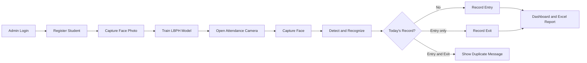

<div align="center">

  

  # AttendVision

  ### Face Recognition Based Attendance Management System

  A modern, browser-based attendance platform that uses computer vision to register
  students, recognize faces, and track daily entry and exit attendance.

  <p>
    
    
    
    
  </p>

  <p>
    <a href="#-features">Features</a> ·
    <a href="#-quick-start">Quick Start</a> ·
    <a href="#-how-it-works">How It Works</a> ·
    <a href="#-troubleshooting">Troubleshooting</a>
  </p>

</div>

---

## ✨ What is AttendVision?

**AttendVision** is a local web application that makes classroom attendance faster
and easier. An administrator registers students, captures their face photos using a
browser camera, trains a recognition model, and scans faces to record attendance.
Attendance records can be reviewed from the dashboard and exported to Excel.

The project is designed for a local academic or small-classroom deployment. It
uses **Flask** for the web server, **SQLite** for local data storage, and
**OpenCV LBPH** for lightweight face recognition.

> **Project status:** Academic prototype for local deployment

### Who is it for?

AttendVision is intended for a teacher, lab administrator, or small academic team
who needs a simple attendance system on one computer. It is not currently designed
as a multi-school cloud platform.

## 🎯 Why AttendVision?

Manual attendance is repetitive, time-consuming, and difficult to search later.
AttendVision provides:

- Contactless camera-based student identification
- Automatic entry and exit time tracking
- Duplicate attendance prevention
- Searchable attendance history
- Excel report generation
- Live dashboard statistics

## 🚀 Features

### 🔐 Secure Administration

- Session-protected administrator dashboard
- Configurable username, password, and secret key
- Clear validation and user feedback

### 👨‍🎓 Student Management

- Register name, unique roll number, email, branch, and academic year
- Capture a student photo directly from the browser camera
- Delete a student and related attendance data
- Search registered students quickly

### 🧠 Face Recognition

- Haar Cascade face detection
- OpenCV LBPH face recognizer
- Face image validation before saving
- Model version and freshness checks
- Configurable confidence threshold

### 🕘 Smart Attendance

- First scan records entry time
- Second scan records exit time
- Third scan is treated as a duplicate
- Configurable college hours
- Status support for early, present, outside-hours, completed, and late attendance

### 📊 Dashboard and Reports

- Registered student count
- Present-today count
- Saved face photo count
- Recognition model readiness
- Seven-day attendance activity chart
- Recent attendance activity
- Attendance history page
- Excel export with student and attendance information

## 🖥️ Interface Preview

The application includes an administrator login, a dashboard for student and model
management, a live attendance camera, and an attendance records view. The project
logo is available at [`static/images/attendvision-logo.png`](static/images/attendvision-logo.png).

## 🛠️ Technology Stack

| Layer | Technology |
|---|---|
| Backend | Python, Flask |
| Computer vision | OpenCV, Haar Cascade, LBPH |
| Database | SQLite |
| Frontend | HTML5, CSS3, JavaScript |
| Camera API | Browser `MediaDevices.getUserMedia()` |
| Excel reports | OpenPyXL |
| Data processing | NumPy |

## ⚡ Quick Start

### 1. Open the project

```bash
cd AttendVision
```

You can also open the project folder directly in VS Code.

### 2. Create a virtual environment (recommended)

Windows PowerShell:

```powershell
python -m venv .venv
.\.venv\Scripts\Activate.ps1
```

macOS/Linux:

```bash
python3 -m venv .venv
source .venv/bin/activate
```

### 3. Install dependencies

```bash
pip install flask opencv-contrib-python numpy openpyxl
```

> `opencv-contrib-python` is required because the LBPH face recognizer is part of
> the OpenCV contrib modules.

### 4. Start the application

```bash
python app.py
```

### 5. Open the application

Open the local URL displayed by Flask, usually:

```text
http://127.0.0.1:5000
```

Camera access works on `localhost` or through HTTPS in browsers that enforce a
secure camera origin.

### 6. Complete the first-time workflow

1. Sign in with the configured administrator credentials.
2. Register a student with a unique roll number.
3. Capture and save a clear face photo in good lighting.
4. Repeat the process for the other students.
5. Click **Train Face Model** after adding or changing face photos.
6. Start the attendance camera and scan a registered student.
7. Use the records page to review attendance or download the Excel report.

> **Important:** Train the model again whenever a new face photo is added or an
> existing photo is changed. The dashboard shows whether the current model is ready.

## 🔑 Configuration

Set environment variables before starting the application. PowerShell example:

```powershell
$env:ADMIN_USERNAME = "admin"
$env:ADMIN_PASSWORD = "change-this-password"
$env:ATTENDANCE_SECRET_KEY = "use-a-long-random-secret"
$env:COLLEGE_START = "08:30"
$env:COLLEGE_END = "16:30"
$env:FACE_CONFIDENCE_THRESHOLD = "110"
python app.py
```

| Variable | Purpose | Default |
|---|---|---|
| `ADMIN_USERNAME` | Administrator username | `admin` |
| `ADMIN_PASSWORD` | Administrator password | `Admin@123` |
| `ATTENDANCE_SECRET_KEY` | Flask session secret | Generated at startup |
| `COLLEGE_START` | Attendance start time in `HH:MM` | `08:30` |
| `COLLEGE_END` | Attendance end time in `HH:MM` | `16:30` |
| `LATE_AFTER` | Time after which attendance is marked late | `09:00` |
| `FACE_CONFIDENCE_THRESHOLD` | LBPH acceptance threshold | `110` |

Attendance after `LATE_AFTER` is marked late when it falls within the configured
attendance window.

> **Security note:** Change the default credentials and set a stable secret key
> before any non-local deployment. Do not commit secrets to the repository.

The application creates `attendance.db`, `face_data/`, and the face-model files as
they are needed. These files contain application data and should be backed up and
protected like any other student record.

## 🔄 How It Works



### Attendance rules

| Scan | System action |
|---|---|
| First successful scan of the day | Creates an attendance row and records entry |
| Second successful scan of the day | Updates the same row with exit time |
| Further scans on the same day | Does not create another attendance record |

## 🗂️ Project Structure

```text
AttendVision/
├── app.py                         # Flask application and API routes
├── attendance.db                  # Local SQLite database (created at runtime)
├── face_model.yml                 # Trained OpenCV model (created at runtime)
├── face_model.version             # Model freshness marker (created at runtime)
├── face_data/                     # Saved student face photos
├── static/
│   ├── script.js                  # Camera, AJAX, search, live stats
│   ├── style.css                  # Responsive application styling
│   └── images/                    # Logo and favicon
├── templates/
│   ├── login.html                 # Administrator login
│   ├── dashboard.html             # Main management dashboard
│   └── attendance.html            # Attendance records
├── tools/
│   └── check_database.py          # SQLite diagnostic helper
├── SEMINAR_REPORT.md              # Detailed seminar report
└── README.md                      # Project documentation
```

`attendance_backup.db` may be present as a local backup. It is not required for a
fresh installation.

## 🧭 Common User Flow

| Step | Administrator action | Result |
|---|---|---|
| 1 | Log in | Protected dashboard opens |
| 2 | Add a student | Student profile is saved |
| 3 | Capture a face | Photo is stored in `face_data/` |
| 4 | Train the model | OpenCV recognition model is updated |
| 5 | Scan a face | Entry or exit time is recorded |
| 6 | Open records/export | Attendance can be reviewed or downloaded |

## 🧪 Testing Checklist

- [ ] Invalid login is rejected
- [ ] Valid login opens the dashboard
- [ ] Duplicate roll number is rejected
- [ ] Invalid or missing face image is rejected
- [ ] Model cannot be used before training
- [ ] First scan records entry
- [ ] Second scan records exit
- [ ] Third scan is not duplicated
- [ ] Attendance records are visible
- [ ] Excel report downloads successfully
- [ ] Deleting a student removes related attendance data

## 🛠️ Troubleshooting

### The camera does not open

Allow camera permission in the browser and open the app through `localhost` or
`127.0.0.1`. Browsers generally block camera access on insecure remote origins.
Close other applications that may already be using the camera.

### Face recognition is unavailable

Install the contrib build of OpenCV, then restart the app:

```bash
pip uninstall opencv-python -y
pip install opencv-contrib-python
```

LBPH is included in `opencv-contrib-python`, not the standard OpenCV package.

### The model is not ready

Confirm that at least one valid face photo exists in `face_data/`, then click
**Train Face Model**. Retrain after every change to the saved face photos.

### Login credentials do not work

The defaults are `admin` and `Admin@123`. If environment variables are set, the
application uses `ADMIN_USERNAME` and `ADMIN_PASSWORD` instead. Restart the app
after changing them.

## ⚠️ Limitations

- Recognition quality depends on lighting, camera quality, face angle, and training
  photos.
- LBPH is lightweight but less robust than modern deep-learning face embeddings.
- The current application is intended for a local administrator and small
  deployments.
- The system does not currently include advanced liveness or anti-spoofing checks.
- Biometric data should be handled according to institutional privacy policies.

## 🔮 Future Enhancements

- Modern embedding-based recognition model
- Liveness and anti-spoofing detection
- Multiple user roles and audit logs
- Monthly attendance percentage and absence analytics
- Branch, date, and academic-year filters
- PostgreSQL support for multi-user deployments
- Cloud backup with encryption
- Email or mobile attendance notifications
- Consent and biometric data retention controls

## 📚 Documentation

- [Seminar report](SEMINAR_REPORT.md)
- [Application source](app.py)

## 🤝 Contributing

1. Create a feature branch.
2. Make focused changes.
3. Test the application locally.
4. Update documentation when behavior changes.
5. Open a pull request with a clear description.

## 📄 License

No license has been specified yet. Add an appropriate `LICENSE` file before
redistributing this project.

## 🔒 Privacy Reminder

Face photos are biometric data. Get appropriate consent, limit access to the
administrator, keep backups secure, and delete records when they are no longer
needed. Follow the privacy rules of your institution and local laws.

---

<div align="center">

  **AttendVision — smarter attendance through computer vision**

</div>
